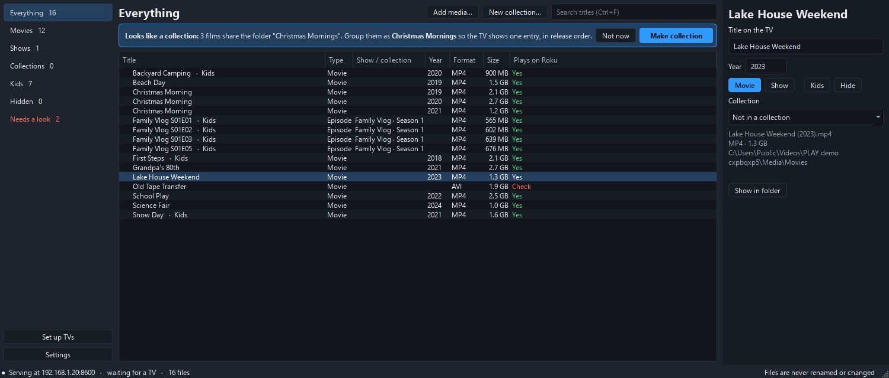

# PLAY

**Your own movies and shows on your Roku, from your Windows PC.** No accounts, no cloud, no transcoding: PLAY serves
the files straight from your drives to the TVs in your house.



- **One library, tagged your way.** One media folder to start (add more if you like). Kids, movie or show, hidden
  and collections are tags inside PLAY, not folders, and they follow a file if you rename or move it. PLAY never
  renames or changes your files; **Add media** copies the files you pick into your media folder (the originals stay).
- **Shows grouped for you.** `Show S01E02`, `1x02`, `Season 1 Episode 2` and `Show/Season 1/E02` all work. PLAY spots
  missing and doubled episodes.
- **Collections.** A film series, or your own "Comedy", shows on the TV as one entry, in release order or your
  own. PLAY suggests series; **New collection…** makes any you like, with search.
- **HOME and KIDS.** The KIDS side of the TV shows only what's marked Kids: mark titles one by one, or pick many at
  once with **+ Add to Kids…**.
- **The TV finds the PC by itself.** No IP addresses to type (there's a fallback if your network blocks it).
- **Resume** where you stopped, per TV, and search across everything.
- **Five skins** (Blue, Ember, Neon, Violet, Crimson), shared with [Bigfoot](https://github.com/AARROWdev/bigfoot) and
  [Cratedig](https://github.com/AARROWdev/cratedig).

## Set up
**Step by step, with pictures of what to press: [docs/INSTALL.md](docs/INSTALL.md).** In short:

1. **On the PC:** install **PLAYSetup-&lt;version&gt;.exe** from the
   [latest release](https://github.com/AARROWdev/play/releases/latest) (Windows 10/11, 64-bit). PLAY starts with one
   media folder, `Videos\PLAY`; **Add media** copies movies and shows there. It lives in the tray and starts with
   Windows, so the TVs can always reach it.
2. **On each Roku TV, once:** turn on Developer Mode with the remote (**Home ×3, Up ×2, Right, Left, Right, Left,
   Right**, then *Enable installer and restart* and set a developer password).
3. **Back on the PC:** click **Set up TVs**, check the TV's IP address matches the one on the TV, and click
   **Install on this TV**. PLAY opens on the TV and finds the PC by itself. Pick HOME or KIDS.

The app isn't code-signed yet, so Windows may show "Windows protected your PC": click **More info**, then
**Run anyway**. The installer lets PLAY through Windows Firewall on private networks only: if the TV can't find
the PC, check that Windows calls your home network **Private** (Settings > Network & internet > your network).

Only one PLAY can serve the TVs on a PC. If another Windows user on the same PC already runs it, yours says so and
closes; use theirs, or quit it there first.

**How to name files:** see [NAMING.md](NAMING.md). In short: `Title (Year).mkv` for movies and
`Show Name S01E02.mkv` for episodes. Anything PLAY gets wrong can be fixed in the window.

**Uninstall:** Settings > Apps > PLAY > Uninstall. This removes the firewall rule and the start-with-Windows entry.
Another Windows user's "Start PLAY with Windows" entry lives in their part of the registry, which an uninstaller
can't reach: switch it off in their PLAY Settings first (left as is, it just points at nothing).
Your tags and collections stay in `%APPDATA%\PLAY\` (delete the folder to remove them too). Your media is untouched.

## How it works
- The PLAY program runs a small web server on port 8600 (changeable in Settings). The TV asks it for the HOME or
  KIDS list and streams files with ordinary HTTP range requests, which is how the Roku player seeks.
- Only files found in your media folders can be streamed. The TV asks for a file by an id, never by a path.
- The TV finds the PC with a UDP broadcast on port 8601 that PLAY answers.
- Each file is recognised by a fingerprint of its size and its first and last 64 KB, so tags follow it through
  renames and moves without PLAY ever writing to it.

## Build
```
python -m venv .venv
.venv\Scripts\python -m pip install -r requirements.txt pyinstaller pytest requests
winget install JRSoftware.InnoSetup   # installer compiler
.\build.ps1   # -> dist\PLAYSetup-<ver>.exe, dist\PLAY-<ver>-portable-win64.zip, dist\PLAY-roku.zip
```
`python play_main.py` runs it from source. `python -m pytest tests` runs the tests; they use temporary folders and
never touch your settings or media. `python tools\roku_build.py <tv-ip>` sideloads the Roku app onto a TV in
developer mode.
